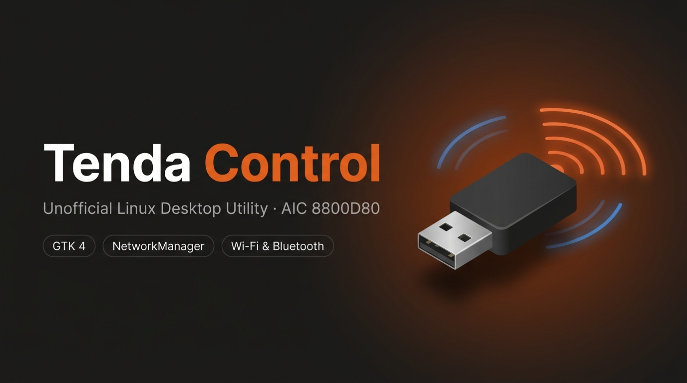

<p align="center">
  
</p>

<h1 align="center">tenda-control</h1>

<p align="center">
  An unofficial Linux desktop utility (GTK 4 + libadwaita + libnm) for managing <strong>Tenda AIC 8800D80</strong> (<code>2604:001f</code>) USB Wi-Fi/Bluetooth adapters alongside your laptop's built-in radios.
</p>

<p align="center">
  
  
  
  
</p>

> **Disclaimer:** This is an independent, community-built open-source project and is **not** affiliated with, endorsed by, or officially supported by Tenda.

---

## Why this exists

Dual-function USB adapters based on the **AIC 8800D80** chipset (`2604:001f`) expose both a Wi-Fi interface and a Bluetooth controller to Linux. On laptops that already have internal Wi-Fi and Bluetooth, plugging one in often leads to duplicate Bluetooth adapters, competing NetworkManager connections, or power-management quirks.

**tenda-control** gives you a clean GNOME/libadwaita GUI to inspect, switch, and persist exactly which radios you want active—without fighting `sysfs`, `nmcli`, and `udev` rules by hand.

## Features

- **Live Radio Overview** — Monitors the USB Tenda Wi-Fi/Bluetooth radios, your internal Wi-Fi card, any internal USB Bluetooth controller (auto-detected via standard USB class `e0/01/01`), and the active IPv4 default route.
- **Built-in Wi-Fi Network Picker** — Uses `libnm` (NetworkManager) directly to connect the Tenda interface to WPA3, WPA2-Personal, open/OWE, and preconfigured WPA-Enterprise (802.1X) networks, including multi-connect profiles and automatic band-compatible AP matching.
- **One-Click Radio Modes & Manual Toggles** — Switch between presets (*Tenda Wi-Fi + Internal BT*, *Internal Wi-Fi + Tenda BT*, *Internal Only*, *All Radios*) or toggle individual interfaces via `pkexec` with automatic rollback on failure.
- **Persistent Plug-in Behavior (`udev`)** — Writes clean rules to `/etc/udev/rules.d/99-tenda-wifi.rules` (backing up any previous file to `.orig`) so your preferred USB radios and power-control settings apply automatically every time you plug the adapter in.
- **Per-Interface Speed Test** — Run manual, cancellable HTTPS latency, download, and upload checks bound directly to the Tenda interface, the internal Wi-Fi card, or the default system route (Cloudflare / LibreSpeed).

## Requirements

- A **Tenda AIC 8800D80** USB adapter (`2604:001f`) with the `aic8800` kernel driver installed.
- **Python 3** with PyGObject bindings for:
  - `GTK 4`
  - `libadwaita >= 1.4`
  - `libnm` (`NetworkManager`)
- CLI tools: `pkexec`, `nmcli`, `ip`, `udevadm`, and `curl`.

## Installation

Clone the repository and run the user-level installer:

```bash
git clone https://github.com/AMorales22T/tenda-control.git
cd tenda-control
./install.sh
```

This installs the application under `~/.local/share/tenda-control`, registers the desktop entry and icon, and makes **Control Tenda** available from your application launcher.

## Project Structure

| File | Purpose |
| --- | --- |
| `tenda_control.py` | Main GTK 4 / libadwaita desktop application |
| `tenda_hardware.py` | Read-only USB, Wi-Fi, Bluetooth, and routing inspection |
| `tenda_helper.py` | Privileged (`pkexec`) radio switcher, USB reset, and `udev` writer |
| `tenda_networks.py` | Native NetworkManager (`libnm`) Wi-Fi picker dialog |
| `tenda_speedtest.py` | Per-interface cancellable HTTPS speed test |
| `install.sh` | Local desktop installer (checks dependencies and creates `.desktop`) |
| `test_tenda.py`, `test_tenda_networks.py` | Unit tests (no live radio changes required) |

## Running Tests

```bash
python3 -m unittest -v test_tenda.py test_tenda_networks.py
```

## License

Licensed under the [MIT License](LICENSE).
